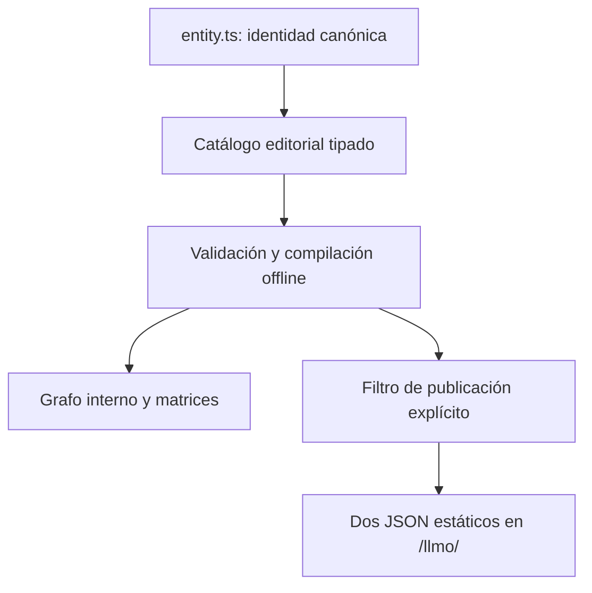

# Knowledge Graph V74 — arquitectura

Un único grafo maestro tipado, con tres vistas lógicas superpuestas cuando corresponde: Entity, Intent y Evidence. No son tres fuentes independientes.

`src/config/entity.ts` continúa siendo autoridad para Organization, Person, WebSite y AETHRYON. `src/seo/routeSeo.js` proporciona URLs de páginas existentes. `src/knowledge/intents.ts` es la autoridad de expresiones; `catalog.ts` concentra los conceptos controlados y las cinco ofertas existentes; `assets.ts` registra páginas; `evidence.ts` registra claims, caso, escenario y metadata WordPress. `graph.ts` deriva los vínculos inversos de assets, capacidades de ofertas y vistas. No se duplican catálogos manuales de esas relaciones.

El compilador consume únicamente datos locales. No llama a red, DB, Search Console, Kyberion, telemetría ni WordPress live. No hay workers, timers, LLMs, embeddings ni servicio de recuperación para visitantes. `retrieval.ts` es un helper de auditoría/test con reglas léxicas curadas, sin recomendar productos automáticamente.

Orden: canonical knowledge → validate → explicit approval/filter → validate public references → generate. El build lo ejecuta antes de Vite, que copia sólo los dos JSON públicos. `data/knowledge/` queda fuera del directorio público y del build del navegador. Ningún componente cliente importa esta capa.

El formato es una ontología propia, no JSON-LD ni Schema.org. Los JSON-LD de las páginas permanecen intactos. Las vistas contienen IDs del mismo maestro, no copias de entidades. Los outputs son derivados y se comprueba igualdad de bytes entre compilaciones; no incorporan reloj, red ni identificadores aleatorios.

Knowledge describe qué creemos/conocemos. Kyberion describe qué está ocurriendo. AETHRYON analiza qué significa la diferencia. V74 implementa sólo la primera capa y sus referencias semánticas, sin conectarlas en tiempo real.

La revisión de rendimiento se limita a comprobar que fuentes visuales, HTML y bundles se conservan. El dato de Hostinger >90 procede del usuario; V74 no lo reinterpreta como medición local nueva.
