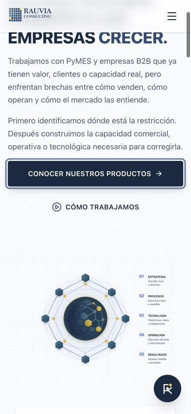

# RAUVIA V73 — estabilización y correcciones mínimas

Fecha: 6 de octubre de 2026. Alcance: fuente derivada de V72, compilación de producción y paquete local. **No publicado**.

El CTA de Home **CONOCER NUESTROS PRODUCTOS** navega a `/soluciones/` en la misma pestaña. Conserva texto, clases, icono, ubicación y reglas responsive. La ruta responde 200 sin redirect. **CÓMO TRABAJAMOS** conserva `/aethryon` y su comportamiento SPA.

V73 incorpora los seis 410 y los 19 redirects solicitados, corrige el auditor de entidades y su relación estructurada faltante, añade la firma secundaria y optimiza tres assets desktop. No se cambian páginas, narrativa ni dependencias. Lint, build, prerender y cuatro auditorías pasan; 147 comprobaciones ejecutadas (141 únicas), sin fallos ni omisiones. El objetivo preferido de LCP desktop <2500 ms **sigue pendiente**.

## 1. Baseline V72

Se congeló `rauvia-platform-v72.zip`, SHA-256 `22926ee3568cd065237dd2ac6a9202a662ee935c90a2f3e58f32e2945ede310e`, y se compiló y examinó antes de editar. Las cifras históricas del informe V72 se usaron como antecedente; la comparación de performance siguiente usa una captura nueva de ambas versiones.

- Build, lint y auditorías SEO, contenido y LLMO: PASS antes del cambio.
- `audit:entities`: dos fallos reproducidos: «Debe incluir al fundador» y «llms.txt debe tener la razón social».
- Dev en Node 24.12.0: fallo heredado `ERR_UNKNOWN_FILE_EXTENSION` al importar `RauviaEditorial.css` desde el renderer SSR cargado por el servidor de desarrollo.
- La primera ejecución HTTP local se bloqueó por permisos del entorno; se repitió con acceso a localhost y pasó. Esa limitación no se cuenta como fallo del sitio.
- La matriz local inicial de 40 peticiones contenía 12×200, 26×404 y 2×410. Los 19 redirects pedidos no estaban en esta fuente, aunque sí aparecían en el sitio público.
- La matriz pública inicial contenía 12×200, 19×301, 7×404 y 2×410. Las seis retiradas aún devolvían 404. Dos URLs inventadas bajo los patrones legacy amplios devolvían 410 indebidamente.

Evidencia: [baseline local](v73-evidencias/http-before-local.json), [baseline público](v73-evidencias/http-before-public.json), [fallos de entidades](v73-evidencias/v73-baseline-entities.log), [fallo dev heredado](v73-evidencias/v73-baseline-dev.log).

## 2. Archivos modificados

Cambios de implementación, tests y documentación respecto al ZIP V72:

| Archivo | Estado |
|---|---|
| `docs/founder-entity-policy.md` | Modificado |
| `docs/phase-0-root-htaccess.md` | Modificado |
| `package.json` | Modificado |
| `scripts/entity-audit.js` | Modificado |
| `server.ts` | Modificado |
| `src/components/AethryonCore.tsx` | Modificado |
| `src/components/Footer.tsx` | Modificado |
| `src/components/HeroSection.tsx` | Modificado |
| `src/pages/NosotrosPage.tsx` | Modificado |
| `src/pages/SolucionesPage.tsx` | Modificado |
| `src/seo/buildMetaTags.ts` | Modificado |
| `tests/aethryon-ux.test.mjs` | Modificado |
| `tests/mobile-experience.test.mjs` | Modificado |
| `public/media/aethryon-convergence-animated-optimized-v73.svg` | Añadido |
| `public/media/rauvia-nosotros-hero-structure-v73.svg` | Añadido |
| `public/media/rauvia-solutions-hero-support-aethryon-v73.svg` | Añadido |
| `server/seo/legacyRoutes.ts` | Añadido |
| `tests/fixtures/wp-growth-post.json` | Añadido |
| `tests/v73-browser-evidence.test.mjs` | Añadido |
| `tests/v73-stabilization.test.mjs` | Añadido |

Se añaden además este informe, el manifiesto V73 y la selección de evidencias. `dist` se regeneró completamente. Las capturas V72 permanecen congeladas; no se reemplaza su baseline para hacer pasar tests.

Inventario y diff: [source-changes.json](v73-evidencias/source-changes.json), [source-changes.diff](v73-evidencias/source-changes.diff).

## 3. Seis URLs 410

`server/seo/legacyRoutes.ts` contiene un inventario exacto de seis nuevas retiradas, ejecutado antes de normalización, static y fallback. La respuesta se produce en Express, sin depender de React ni JavaScript. Los inventarios exactos de URLs retiradas anteriores se conservan; se eliminan los patrones amplios que trataban URLs inventadas como retiradas.

## 4. Status comprobado de cada retirada

| URL | GET/HEAD, con/sin slash | Location | Robots HTML |
|---|---|---|---|
| `/copywriting-textos-vender-facebook-pymes/` | 410 | Ausente | noindex,follow |
| `/marketing-bajo-presupuesto-5-estrategias/` | 410 | Ausente | noindex,follow |
| `/despega-tu-marketing/` | 410 | Ausente | noindex,follow |
| `/tag/facebook-ads/` | 410 | Ausente | noindex,follow |
| `/tag/consultoria-para-pymes/feed/` | 410 | Ausente | noindex,follow |
| `/category/startups-y-emprendimiento/feed/` | 410 | Ausente | noindex,follow |

Todas tienen body HTML mínimo en GET y vacío en HEAD; `Cache-Control: public, max-age=300`; también `X-Robots-Tag: noindex, follow`. No contienen canonical, JSON-LD, script ni redirect; tampoco aparecen en sitemap. Los enlaces opcionales a soluciones y recursos no alteran el 410. El manejo añade **0 client JS**.

Evidencia: [matriz HTTP final](v73-evidencias/http-final-local.json) y [pruebas de producción](v73-evidencias/v73-test-final.log).

## 5. Redirects auditados

Resultados del servidor de producción compilado, con datos WordPress de prueba tomados de los artículos publicados:

| Origen | Destino canónico | Resultado / saltos |
|---|---|---|
| `/errores-planeacion-estrategica-90-dias/` | `/ruta-90/` | 301 → 200 / 1 |
| `/categoria-producto/estrategia-y-planificacion/` | `/aethryon/` | 301 → 200 / 1 |
| `/privacidad/` | `/aviso-de-privacidad/` | 301 → 200 / 1 |
| `/brand/rauvia-consulting/` | `/nosotros/` | 301 → 200 / 1 |
| `/categoria-producto/servicios-de-consultoria/` | `/soluciones/` | 301 → 200 / 1 |
| `/tag/errores-de-negocio/` | `/recursos/` | 301 → 200 / 1 |
| `/etiqueta-producto/consultoria-estrategica/` | `/soluciones/` | 301 → 200 / 1 |
| `/tag/transformacion-digital/` | `/recursos/` | 301 → 200 / 1 |
| `/tag/innovacion/` | `/recursos/` | 301 → 200 / 1 |
| `/tag/sistemas-de-negocio/` | `/soluciones/` | 301 → 200 / 1 |
| `/tag/consultoria-cdmx/` | `/soluciones/` | 301 → 200 / 1 |
| `/tag/gestion-de-equipos/` | `/recursos/la-ilusion-del-crecimiento-sin-capacidad/` | 301 → 200 / 1 |
| `/clients/` | `/casos/` | 301 → 200 / 1 |
| `/ruta-90-dias-rauvia-para-quien-es/` | `/ruta-90/` | 301 → 200 / 1 |
| `/category/automatizacion-empresarial/` | `/soluciones/` | 301 → 200 / 1 |
| `/tag/crecimiento-de-negocio/` | `/recursos/la-ilusion-del-crecimiento-sin-capacidad/` | 301 → 200 / 1 |
| `/guia-definitiva-como-usar-el-seo-basico-para-superar-a-tu-competencia-en-marketplaces/` | `/recursos/` | 301 → 200 / 1 |
| `/marketing-deficiente-la-razon-silenciosa-que-mata-al-90-de-las-startups-y-como-evitarla/` | `/recursos/brecha-capacidad-real-percepcion-mercado/` | 301 → 200 / 1 |
| `/marketing-deficiente-la-razon-silenciosa-que-mata-al-90-de-las-startups-y-como-evitarla/feed/` | `/recursos/brecha-capacidad-real-percepcion-mercado/` | 301 → 200 / 1 |

GET con/sin slash y HEAD con query pasan. La query se conserva. Para `www` se emite directamente la URL HTTPS canónica del sucesor, sin pasar por una normalización intermedia. Los dos sucesores editoriales existen en el sitio público; las pruebas no crean ni publican artículos.

Además, ocho páginas principales son 200 y ocho URLs inventadas son 404 sin Location. Las rutas exactas `/blog` y `/servicios` conservan sus redirects; sus descendientes inventados ya no se redirigen en bloque. [Pruebas y assertions](../tests/v73-stabilization.test.mjs).

## 6. Redirect chains encontrados

La muestra pública previa de los 19 orígenes tuvo un 301 y un 200 en cada caso: **cero cadenas múltiples y cero loops**. Había tres destinos distintos a los pedidos:

| Origen | Público antes | Fuente V73 |
|---|---|---|
| `/etiqueta-producto/consultoria-estrategica/` | `/aethryon/` | `/soluciones/` |
| `/tag/sistemas-de-negocio/` | `/recursos/` | `/soluciones/` |
| `/category/automatizacion-empresarial/` | `/recursos/` | `/soluciones/` |

La fuente y el sitio público no coincidían. No se ha localizado ni modificado una configuración upstream en Hostinger. Si el proxy/hosting conserva reglas que se ejecutan antes de Express, habrá que alinearlas al publicar y repetir estas 19 peticiones públicas. No se puede afirmar que el ZIP por sí solo sustituya reglas externas.

`docs/phase-0-root-htaccess.md` queda señalado expresamente como histórico: su viejo fallback/Home redirect no debe instalarse como configuración V73. No hay un `.htaccess` activo modificado en este proyecto.

[Resultados públicos previos](v73-evidencias/redirects-public-before.json).

## 7. Artefactos de prueba ignorados

`/sitio-web-comercial-para-pymes/%20https://rauvia.com.mx/...` se clasifica **TEST / OBSERVATION ARTIFACT**. No se añade un redirect específico; no se usa como evidencia de enlace roto, error orgánico ni intención de crawler.

Probes, servidores de QA, identidades de las sesiones de prueba y experimentos intermedios se mantienen fuera del paquete. La evidencia del CTA sólo conserva nombre del evento, página y propiedades necesarias, sin identificadores de usuario.

## 8. Desktop LCP antes/después

Laboratorio Chromium, 1440×1000, gzip, cola de red compartida de 1.6 Mbps y 100 ms por petición, sin shaping de CPU. Una carga fría y una recarga por ruta/versión; la recarga no garantiza caché completa. Se esperó la imagen significativa antes de aceptar la lectura. No son percentiles de campo ni una certificación CWV.

| Ruta | LCP frío V72 → V73, ms | LCP recarga V72 → V73, ms |
|---|---|---|
| `/` | 3052 → 2732 | 2716 → 2804 |
| `/soluciones/` | 2700 → 2568 | 2704 → 3040 |
| `/nosotros/` | 5080 → 3904 | 5028 → 4032 |

La muestra fría mejora Home 10.5%, Soluciones 4.9% y Nosotros 23.1%. **Las tres permanecen por encima de 2500 ms**. Las recargas de Home y Soluciones fueron más lentas; se documenta esa variación, sin prometer una mejora uniforme. Con una observación por combinación y CPU no controlada no puede concluirse una regresión persistente ni una garantía estadística.

CLS desktop frío ≈0.00035; recargas 0. La muestra móvil de las tres rutas tuvo CLS 0. [Observaciones y recursos completos](v73-evidencias/performance.json).

## 9. Candidato LCP antes/después

| Ruta | Candidato antes | Candidato después |
|---|---|---|
| Home | IMG `aethryon-convergence-animated-optimized.svg` | Mismo IMG, asset `aethryon-convergence-animated-optimized-v73.svg` |
| Soluciones | IMG `rauvia-solutions-hero-support-aethryon.svg` | Mismo IMG, asset `rauvia-solutions-hero-support-aethryon-v73.svg` |
| Nosotros | IMG `rauvia-nosotros-hero-structure.svg` | Mismo IMG, asset `rauvia-nosotros-hero-structure-v73.svg` |

Los tres SVG contenían el mismo bitmap PNG dominante. Se creó una derivada con ese bitmap en WebP lossless; el resto del SVG es idéntico, incluidos geometría, texto, estilos y animación. Se preservan los originales. No se oculta ni retrasa el contenido para cambiar el candidato.

| Asset derivado | Bytes gzip antes → después | Ahorro |
|---|---|---|
| `aethryon-convergence-animated-optimized-v73.svg` | 187028 → 143811 | −43217 |
| `rauvia-solutions-hero-support-aethryon-v73.svg` | 186211 → 142995 | −43216 |
| `rauvia-nosotros-hero-structure-v73.svg` | 187224 → 143995 | −43229 |

El bitmap visible conserva sus canales RGBA; se descarta únicamente RGB oculto bajo alpha cero. La comparación de decodificación/composición del bitmap en Chromium encontró redondeo máximo de 1/255 por canal. Un render de librería no dio identidad completa y se registra en la evidencia; no se afirma pixel-perfect de todo el SVG ni compatibilidad física multiplataforma certificada.

[Optimización](v73-evidencias/svg-optimization.json), [comparación en navegador](v73-evidencias/bitmap-browser.json).

## 10. Cambios Home

El CTA utiliza el `Link` existente de React Router con `to="/soluciones/"`. Se retira su lógica de WhatsApp y `target="_blank"`. El HTML inicial contiene `<a href="/soluciones/">`; no depende sólo de onClick. No hay modal, asistente ni scroll interno asociado a la acción.

Analytics reutiliza **`cta_click`**, con `source_page: '/'`, `destination: '/soluciones/'` y `context: 'product_discovery'`. No se crea taxonomía, identificador ni arquitectura nueva. La captura intercepta eventos localmente; no escribió telemetría en producción.

En 390×844, 850×1000 y 1440×1000: clases e icono de ambos CTA idénticos al baseline; variación geométrica máxima <0.12 CSS px, tolerancia explícita 0.25 por redondeo. Altura táctil del primario: 52, 44 y 64 px. Click y Enter llegan a `/soluciones/` en la misma pestaña. Focus visible con outline sólido de 3 px. El segundo CTA sigue navegando por SPA a `/aethryon`; su normalización HTTP canónica existente no se cambia.

Home también utiliza la derivada SVG desktop de menor peso. Sus fuentes móviles 640/960 y sus reglas responsive permanecen idénticas.

[Validación de los diez requisitos](v73-evidencias/cta-validation.json), [eventos sin identidad](v73-evidencias/cta-analytics.json), [pruebas de evidencia](../tests/v73-browser-evidence.test.mjs).



## 11. Cambios Soluciones

Se cambia únicamente la referencia al SVG desktop derivado. Texto, selector, tabla, estructura y fuentes móviles se conservan. No se agrega un preload desktop global. Candidato móvil: el mismo `rauvia-solutions-hero-mobile-640.webp`.

## 12. Cambios Nosotros

Se utiliza la derivada SVG y un preload de imagen limitado a `media="(min-width: 1024px)"`, con prioridad alta. Se conserva la carga lazy del IMG fuera de esa anticipación desktop. No se anticipa esa imagen en móvil. Sin cambios de dimensiones, visibilidad, mensaje ni ubicación. El recurso es menor y comienza antes; no se midió aisladamente el tiempo de decode, por lo que no se atribuye a ese factor una ganancia cuantificada.

## 13. audit:entities antes/después

Antes: dos errores reproducidos. Después: **0 errores / PASS**. Fuente canónica `src/config/entity.ts` sin cambios; se mantienen **Raúl Antonio Morales Domínguez**, su rol y `https://rauvia.com.mx/#raul-morales`.

La Organization base prerenderizada ahora refiere a ese ID mediante `founder`; Person conserva `worksFor` hacia `#organization`. Home ya incorporaba una relación founder y no cambió su JSON-LD. El auditor usa el loader `tsx` ya instalado para leer la fuente canónica; no se instala una dependencia.

[Auditoría final](v73-evidencias/v73-entities.log), [política actualizada](founder-entity-policy.md).

## 14. Causa real de los dos fallos

El auditor heredado buscaba el substring «Raúl Morales», que no coincide con el nombre completo existente. La presencia del fundador no faltaba en la configuración. Al verificar los datos realmente prerenderizados se encontró una omisión adicional: Organization no enlazaba a Person, aunque Person ya enlazaba a Organization. Se corrigió esa relación puntual.

El segundo check exigía a `llms.txt` repetir la razón social. La guía pública usa marca y fundador y enlaza la ficha estructurada. Se comprueba la razón social existente contra `ENTITIES.organization.legalName` en `public/llmo/organization.json` y en JSON-LD; no se inventa ni duplica información corporativa. Se documenta esta política, en vez de alterar la razón social o el ID estable para satisfacer un substring.

Ruta 90 permanece **método adoptado/usado por RAUVIA**. Sus páginas, datos y atribución no cambian; no se añade «creado» o «desarrollado» por RAUVIA/Raúl al método ni a SEO/GEO.

## 15. Polish y correcciones aplicadas

| Ruta / viewport | Elemento / problema | Clase | Cambio |
|---|---|---|---|
| Home / todos; comprobados los tres tamaños CTA | Descubrimiento de oferta enviaba a WhatsApp | P0 | Link interno a soluciones y contexto correcto del mismo evento |
| Inventarios legacy / cualquier viewport | Falta de seis 410 y reglas fuente; URLs inventadas mal clasificadas | P0 | Middleware exacto y fallback 404 conservado |
| Entidades / HTML inicial | Auditor desactualizado y relación founder faltante | P0 | Auditor canónico y referencia al ID vigente |
| Dev / Node 24 | Renderer de producción importaba CSS fuera de Vite | P0 | Import dinámico dentro de la rama de producción |
| Home/Soluciones/Nosotros / desktop ≥1024 | SVG con bitmap de transferencia elevada | P1 | Bitmap lossless y preload desktop sólo en Nosotros |
| Footer / siete tamaños comprobados | Firma secundaria solicitada ausente | P2 | Texto discreto, sólo marca enlazada, misma pestaña |

No se modifica CSS responsive global. Se revisaron los componentes editados con el checklist React: enlaces semánticos, ninguna nueva condición de hooks, accesibilidad y división de rutas conservadas.

## 16. Polish rechazado

Se descartó la conversión de PNG a paleta que alteraba colores. También se descartó una recompresión PNG de ahorro muy pequeño frente a la derivada lossless. No se aplica rediseño, cambio estético P3, nueva animación, skeleton, ocultación del hero, cambio de CTA secundario ni reorganización de contenidos. No se inicia Knowledge/Intent/Evidence Graph.

## 17. Footer final

**Experiencia digital desarrollada por RAUVIA Consulting**. Sólo la marca es enlace a `https://rauvia.com.mx/`, en la misma pestaña; altura del enlace 44 px y focus visible. Sin logo, icono ni animación adicionales. Los enlaces técnicos `/llms.txt`, `/robots.txt`, `/sitemap.xml` y «GEO & LLM Dossier» no aparecen en el footer.


## 18. SEO diff

Las ocho rutas conservan title, description, canonical, robots, OG, Twitter y H1. JSON-LD de Home es idéntico; las otras siete sólo añaden la referencia `Organization.founder` al ID existente. El HTML inicial cambia de manera deliberada por CTA, firma, referencias de assets, preload de Nosotros, referencia founder y nombres de bundles recompilados.

Tests de landings, legales y caso individual conservan el hash congelado V72 tras normalizar únicamente firma, referencia founder, hints de build e IDs generados. No se reescriben títulos o atribuciones para hacer pasar el test.

[Diff SEO completo](v73-evidencias/seo-diff.json). **91 archivos protegidos** son byte a byte idénticos, incluyendo páginas médicas/comerciales/legales/caso, `MainNavbar`, `App`, `routeLoader`, estilos responsive, machine-readable references, configuración de entidades y módulos de analytics. [Hashes de protección](v73-evidencias/protection.json).

## 19. Sitemap diff

Sitemap comparado: idéntico, SHA-256 `762e9d3e79f5186d2948b8e2de518890f219366089792218b6ef4245cf3f2686`. Ninguna retirada nueva está en él. Se conservan scripts y comportamiento de actualización existente. Esta comparación confirma contenido y preservación del código local; no certifica una ejecución futura del refresco en producción.

[Diff sitemap](v73-evidencias/sitemap-diff.json). Discovery local `/llms.txt`, `/llmo/index.json`, `/robots.txt`, `/sitemap.xml`: 200.

## 20. Mobile regression

56 combinaciones únicas: ocho rutas principales × 320×568, 360×800, 390×844, 430×932, 700×900, 850×1000 y 1440×1000. PASS: H1 único, sin desbordamiento documental, sin targets bajo 44 px dentro de tolerancia de render y sin imágenes visibles rotas. Se comprobó además menú 390×844: panel dentro del viewport, body lock, Escape, cierre y devolución del foco a «Abrir menú».

| Ruta | LCP frío phone 390×844 V72 → V73, ms |
|---|---|
| `/` | 1400 → 800 |
| `/soluciones/` | 2212 → 1040 |
| `/nosotros/` | 1048 → 796 |

En estas muestras no se observó empeoramiento móvil. CPU no controlada y una sola observación impiden atribuir toda la diferencia al cambio de código. Home/Soluciones conservan bytes de assets móviles; safe areas, svh/dvh, fold progressive enhancement y reduced motion conservan su fuente. No se exige repetir las 104 combinaciones completas porque no se cambia CSS responsive global.

[Matriz 56](v73-evidencias/mobile-matrix.json), [teclado y menú](v73-evidencias/keyboard-menu.json). No es QA de iOS/Android/foldable físico ni un test nuevo de segmentos físicos.

## 21. Bundle delta

JS inicial gzip: cierre de imports y hints de prerender, sin contar dos veces un mismo asset. Bytes:

| Ruta | V72 | V73 | Delta |
|---|---|---|---|
| `/` | 200615 | 200797 | +182 |
| `/soluciones/` | 205795 | 205944 | +149 |
| `/aethryon/` | 164709 | 164846 | +137 |
| `/ruta-90/` | 160814 | 160951 | +137 |
| `/frente-comercial/` | 163001 | 163145 | +144 |
| `/nosotros/` | 198537 | 198744 | +207 |
| `/recursos/` | 251352 | 251492 | +140 |
| `/casos/` | 195797 | 195938 | +141 |

Máximo +207 bytes, dentro de la preferencia +2 kB por ruta. CSS inicial compartido +53 bytes por las clases locales de la firma. Route-level code splitting se conserva. Recursos continúa ligeramente sobre la preferencia histórica de 250 kB gzip; no se corrige mediante refactor ajeno al alcance.

Dependencias, devDependencies, overrides y lock idénticos a V72. Sin runtime adicional, nuevos identificadores ni tablas. [Detalle por asset](v73-evidencias/bundle.json).

## 22. Tests

Lint, build completo y prerender: PASS. Se regeneran veinte rutas públicas y 404; también se incluye el shell de implementación (22 HTML en dist).

| Log de la ejecución final elegida | PASS | FAIL | SKIP |
|---|---|---|---|
| `v73-test-seo.log` | 48 | 0 | 0 |
| `v73-test-aethryon.log` | 9 | 0 | 0 |
| `v73-test-ruta90.log` | 9 | 0 | 0 |
| `v73-test-regression.log` | 20 | 0 | 0 |
| `v73-test-dev-urls.log` | 11 | 0 | 0 |
| `v73-test-final.log` | 50 | 0 | 0 |

Total **147 ejecutadas / 141 únicas**: los seis tests unitarios de eventos Ruta90 se ejecutan en dos scripts. `test:v73` reúne 44 tests HTTP/HTML contra el servidor compilado y seis assertions sobre observaciones CUA con fingerprints de fuente. Estas seis assertions validan evidencia capturada por navegador; no pretenden relanzar por sí solas un navegador.

Cobertura adicional: SEO/SSR, WordPress cache, AETHRYON, Ruta90, favicon, landing profesionales, normalización URL prod y dev, deep links, HTML protegido y separación de bundles. Dev comprueba que `/@react-refresh` y `/@vite/client` siguen entregando JavaScript sin redirect. No hay tests omitidos. Auditorías `audit:seo`, `audit:entities`, `audit:content`, `audit:llmo`: PASS. Consola de Home al cierre: ningún warn/error entre los avisos disponibles de la captura final.

Para repetir: `npm run lint`, `npm run build`, `npm run test:v73`, scripts `test:seo`, `test:aethryon`, `test:ruta90-integration`, `test:favicon` y los tests de normalización/mobile; las suites HTTP externas requieren una instancia local en su `TEST_BASE_URL` según sus archivos. Auditorías después de build. Los fixtures CMS son locales y no escriben datos de producción.

[Resumen de tests](v73-evidencias/test-summary.json), [build](v73-evidencias/v73-build.log), [lint](v73-evidencias/v73-lint.log), [SEO audit](v73-evidencias/v73-audit-seo.log), [content audit](v73-evidencias/v73-content.log), [LLMO audit](v73-evidencias/v73-llmo.log).

## 23. Warnings

El build conserva dos avisos esbuild sobre `import.meta` en salida CJS de WordPress y el aviso de Vite sobre `__dirname` con un futuro configLoader native. No bloquean build ni la validación actual. El puerto HMR 24678 estaba ocupado por un proceso ajeno; el servidor dev validado sirve correctamente y no se termina ese proceso ajeno.

El fallo Node24/CSS del baseline sí se corrigió, limitando el import al renderer de producción; no se añadió un loader. No se introduce un refactor de Vite para resolver avisos heredados fuera del alcance.

## 24. Deuda restante y operación post-deploy

- LCP frío desktop: Home 2732 ms, Soluciones 2568 ms, Nosotros 3904 ms. Se requiere más muestra y diagnóstico controlado para garantizar <2500 ms y aclarar recargas.
- Verificar publicamente las seis respuestas 410 y las 19 rutas tras desplegar, incluidas las tres reglas que antes tenían destinos distintos. Las reglas upstream no están certificadas por estas pruebas de Express.
- Repetir smoke real de Safari/iOS, Android y foldable cuando exista acceso físico; no se declara certificación con tamaños emulados.
- Comprobar la actualización del sitemap y escritura de crawler telemetry en el entorno desplegado, sin inferir intención del crawler.

Se conserva `ai_crawler_visits` y su middleware existente de `res.on('finish')`, ahora ubicado antes de los nuevos 410/301 para observar su status final naturalmente. No se crea una tabla/evento ni se escribe contra la base real en QA. Consulta proporcionada para después del deploy, sólo documentada:

```sql
SELECT
    request_path,
    status_code,
    crawler_name,
    COUNT(*) AS hits,
    MIN(requested_at) AS first_seen,
    MAX(requested_at) AS last_seen
FROM ai_crawler_visits
WHERE site_id = 'rauvia-main'
  AND status_code IN (301, 404, 410)
GROUP BY request_path, status_code, crawler_name
ORDER BY last_seen DESC;
```

No se integra ni ejecuta esta consulta. El insert documentado por el código actual no incluye `site_id`; antes de usar el filtro, confirmar el esquema desplegado y la asignación de ese campo. No se añade una columna ni se altera la tabla para satisfacer este reporte.

## 25. Readiness de producción

**Implementación y paquete local completos para revisión y despliegue**: seis nuevas retiradas 410, 19 sucesores directos 301→200, desconocidas 404, CTA semántico y navegable, entidades coherentes, footer secundario, contenido/SEO preservados, sin nuevas dependencias/páginas/telemetría/Knowledge Graph.

El ZIP contiene fuente, tests, `dist/server.cjs`, assets compilados, veinte rutas prerenderizadas, 404, shell, informe y evidencias seleccionadas. Manifiesto SHA-256 por archivo y CRC del ZIP se verifican en `outputs/v73-paquete.json`; el SHA externo está en `outputs/rauvia-platform-v73.sha256`. Se excluyen node_modules, secrets `.env`, helpers de laboratorio y probes runtime. Las versiones anteriores se conservan como antecedentes, con su manifiesto histórico fuera del ZIP V73.

**Límites de readiness:** no publicado; sin garantía de LCP <2500 ms ni certificación física/field-CWV. La aceptación pública requiere comprobar el routing upstream. V74 puede trabajar sobre esta fuente estabilizada; V73 no implementa su Knowledge & Intent Graph.
