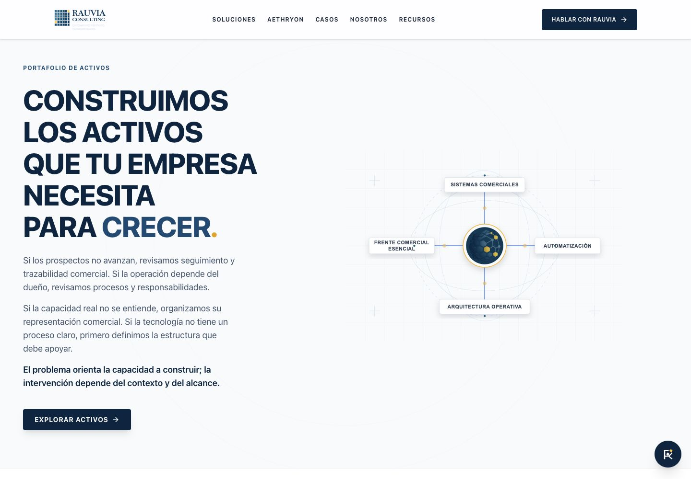

# RAUVIA V75 — Retrieval, Citation & Authority Layer

Cierre local: 7 de octubre de 2026. V75 está implementado y compilado; **no está desplegado**. Prepara relaciones recuperables y citas con límites, sin demostrar que Gemini o ChatGPT mencionen más a RAUVIA. WordPress, perfiles externos y sitios de clientes no se han publicado ni modificado.

## Resultado

| Elemento | Estado final |
|---|---|
| Intenciones V74 | 64 públicas cubiertas; 9 hipótesis siguen internas; ningún Intent nuevo por frase |
| Query Archetypes | 64 arquetipos, 96 expresiones; formulaciones editoriales, no demanda observada |
| Canonical Answers | 18 respuestas y familias, con problemas, capacidades, entidades, assets, claims y límites |
| Citation Bundles | 18 conjuntos; 9 claims y 24 fuentes institucionales/editoriales referenciadas |
| V74 | 219 nodos internos / 208 públicos: sólo tres Claim de alcance añadidos; nodos públicos anteriores e intent coverage intactos |
| Recuperación pública | Tres JSON estáticos, registrados en index.json y ambos llms.txt |
| Ajuste / exclusiones | Condiciones FIT, POSSIBLE_FIT y NOT_PRIMARY_FIT; ninguna recomendación universal |
| Autoridad externa | Nueve superficies planificadas, matriz de 18 familias, revisión externa pendiente |
| WordPress | Diez artículos clasificados: ocho KEEP y dos UPDATE; ninguna acción editorial ejecutada |
| Gaps editoriales | Once briefs de catálogo REVIEW/LATER; no demanda acreditada ni publicación autorizada |
| Benchmark externo | Seis ICPs preparados; matriz de observaciones vacía, sin scores ni resultados inventados |

La tesis canónica permanece: RAUVIA ayuda a empresas con capacidad real que encuentran una brecha entre lo que pueden hacer, cómo lo entiende el mercado y cómo está estructurada su operación. Primero identifica qué está limitando el avance y después construye la capacidad comercial, operativa o tecnológica necesaria.

## Arquitectura y límites

[Catalog](../src/retrieval/catalog.ts) es la autoridad editorial de esta capa y consume los IDs aprobados de V74. [Compiler](../src/retrieval/compiler.ts) genera las proyecciones y matrices; [validator](../src/retrieval/validate.ts) y las pruebas controlan referencias, cobertura, soporte, límites, condiciones, repetición, garantías, causalidad y atribución. No se importan estos módulos en el navegador.

Query → Intent → Answer Family → Canonical Answer → Problem / Capability / Entity → Citation Bundle → Claim → Source → Scope / Period / Attribution Limit. En las respuestas de identidad, Problem y Capability describen un contexto de aplicación (`application_context`), no un diagnóstico del visitante.

Los tres recursos a servir tras el despliegue son:

- [/llmo/retrieval-map.json](../public/llmo/retrieval-map.json)
- [/llmo/canonical-answers.json](../public/llmo/canonical-answers.json)
- [/llmo/citation-bundles.json](../public/llmo/citation-bundles.json)

Las copias en dist coinciden con public. Las pruebas HTTP confirman 200 sin redirección, JSON válido y ausencia de datos privados. Se deniegan con 404 las rutas de matrices, pruebas, fuentes y documentación interna. No se creó una API de conversación, se duplicó Schema.org ni se publicó una hipótesis V74.

El [helper de recuperación](../src/retrieval/retrieve.ts) es **offline y determinista**: reconoce los alias revisados, puede indicar ambigüedad o falta de coincidencia y devuelve POSSIBLE_FIT. No es un buscador semántico, un diagnóstico ni una prueba de recuperación por LLM. Frente Comercial requiere oferta/capacidad existentes y una brecha de representación; Ruta 90 requiere prioridad identificada y ejecución; automatización requiere proceso definido. Campañas de Facebook Ads para 500 leads y ecommerce de 50,000 productos no devuelven Frente Comercial como solución principal.

El [corpus](../data/knowledge/retrieval-tests.json) comprueba ocho consultas positivas y tres negativas; sus [recorridos](v75-evidencias/retrieval-examples.json) son resultados locales, no respuestas de Gemini. Las 18 respuestas usan soporte institucional con límites editoriales: ofrecer una capacidad no prueba resultados ni causalidad.

### Atribución y evidencia

Ruta 90 se conserva como **método adoptado y utilizado por RAUVIA**, sin autoría de RAUVIA ni Raúl Morales. AETHRYON conserva identidad como System desarrollado por RAUVIA, sin convertirse en salida obligatoria hacia Ruta 90 ni solución universal.

El caso B2B conserva el dato publicado de **3,564 conversaciones iniciadas**, no conversaciones analizadas, leads, clientes o cierres. El benchmark interno 2.67 → 4.00 no equivale a ventas ni prueba causalidad. La trazabilidad sigue en construcción. Consultorio Áurea es un escenario ilustrativo, no un caso real con resultados demostrados.

Las fuentes de WordPress se asocian por metadata del snapshot V74. Sus cuerpos no se certifican como evidencia de eficacia; toda fila editorial indica BODY_REVIEW_PENDING. La fecha `last_reviewed` de las citas corresponde a la revisión editorial del 6 de octubre; el cierre técnico del paquete ocurrió el día 7.

## Cambios visibles y congelación

Sólo se ajustaron textos existentes de Nosotros, Soluciones, AETHRYON, Frente Comercial y Casos. Nosotros incorpora la tesis; Soluciones relaciona problemas con capacidades; AETHRYON delimita utilidad; Frente Comercial precisa ajuste; Casos establece contexto, intervención, cambio reportado, evidencia y límites.

Se compararon 115 archivos de implementación existentes con el ZIP V74. Únicamente difieren esas cinco páginas y el catálogo de tres Claim. Servidor, middleware, telemetría, identidad, rutas, loaders, estilos, imágenes, componentes de Home y landings protegidas conservan la fuente anterior.

Los 13 CSS productivos son **idénticos byte por byte**. En 22 HTML, el head SEO se conserva y sólo cinco cuerpos presentan los cambios autorizados; las otras 17 salidas coinciden tras normalizar exclusivamente nombres de assets con hash. WordPress conserva su metadata, el contenido de Recursos y el bundle cliente anterior con el endpoint real del blog. No se modificó el sitemap ni su lógica de actualización.

Home conserva CONOCER NUESTROS PRODUCTOS → /soluciones/ en la misma pestaña, y CÓMO TRABAJAMOS → /aethryon. Texto, icono, clase y geometría se comparan con la captura histórica; teclado, foco visible, Escape, restauración de foco y bloqueo de scroll se verificaron en navegador. La taxonomía CTA procede de la evidencia V73 y se mantiene vigente por invariancia del handler y la fuente de analytics; no se presenta como escritura actual en una base de datos real.

## Seguridad puntual

Entorno registrado: Node 24.12.0 y npm 11.6.2. Baseline previo, árbol efectivo, audit, comparación de lockfile y evidencias están en [security](v75-evidencias/security/lock-diff.json). No se usó audit fix --force ni se actualizaron paquetes ajenos.

| Package | Previous Version | Final Version | Direct/Transitive | Parent Package | CVE / Severity | Remediation | Runtime/Build Scope | Validation | Status |
|---|---|---|---|---|---|---|---|---|---|
| proxy-addr | 2.0.7 | 2.0.8 | Transitiva; profundidad 2; una instancia | Express 5.2.1 | CVE-2026-90711 / CRITICAL | Resolución compatible con el rango del padre, sin override | Runtime servidor; no bundle cliente | IPv4-mapped IPv6, CIDR, XFF, Express y límite por IP | Corregida |
| source-map-js | 1.2.1 | 1.2.2 | Transitiva; profundidad 3; una instancia deduplicada | @tailwindcss/node 4.3.3 y PostCSS 8.5.28 vía Autoprefixer 10.5.4 | CVE-2026-93749 / HIGH | Resolución compatible, sin override | Tooling/build; no bundle cliente ni uso en runtime servidor | Offsets excesivos, SourceNode, Vite, CSS, prerender y sourcemap servidor | Corregida |
| postcss-selector-parser | 6.0.10 | 7.1.6 | Transitiva; profundidad 2; una instancia | @tailwindcss/typography 0.5.20 | CVE-2026-104844 / MODERATE | Override limitado a este consumidor después de análisis y pruebas | Plugin de build; no bundle cliente ni uso en runtime servidor | API del consumidor, 2,182 selectores, CSS final idéntico y build | Corregida |

Express instalado ya admite la versión corregida de proxy-addr. Los consumidores de source-map-js admiten su parche. Typography instalado sigue fijando parser 6.0.10; se revisó el salto mayor y se acotó el override al plugin. Su integración usa astSync, nodos, remove/prepend y serialización; el cambio mayor de inserciones durante iteración no se usa en ese recorrido. No se amplió el override a todo el árbol.

Los resultados de parser 6.0.10 y 7.1.6 fueron idénticos en 2,182 selectores y operaciones del consumidor. El [corpus comprimido](v75-evidencias/security/parser-corpus.json.gz) conserva su huella y la prueba final vuelve a procesarlo con el parser corregido. El build real de Typography/PostCSS produjo los mismos 13 CSS.

El [lockfile](v75-evidencias/security/lock-diff-fields.json) cambia únicamente tres entradas: versiones, resolved, integrity y metadata funding de proxy-addr. Dependencias directas y devDependencies permanecen iguales. La evidencia anterior incluye cuatro findings de audit por el efecto transitivo sobre Typography, aunque los paquetes vulnerables objetivo son tres.

Fuentes primarias: [proxy-addr advisory](https://github.com/advisories/GHSA-jqcg-44mw-7w3h) y [release 2.0.8](https://github.com/jshttp/proxy-addr/releases/tag/v2.0.8); [source-map-js advisory](https://github.com/advisories/GHSA-68fv-2mgg-jv7q) y [release 1.2.2](https://github.com/7rulnik/source-map-js/releases/tag/v1.2.2); [parser advisory](https://github.com/advisories/GHSA-rj75-hqrm-r3gf), [changelog](https://github.com/postcss/postcss-selector-parser/blob/main/CHANGELOG.md) y [release 7.1.6](https://github.com/postcss/postcss-selector-parser/releases/tag/7.1.6).

### Remaining security findings

El [npm audit final](v75-evidencias/security/audit-after.json), obtenido el 7 de octubre de 2026, informa **0 findings conocidos** en este árbol. Esto no certifica el sitio ni demuestra ausencia de vulnerabilidades no detectadas.

`trust proxy` no se modificó: la aplicación conserva el valor por defecto false. Se probaron la política actual y un proxy loopback explícito en una aplicación aislada de test, sin ampliar redes del proyecto. X-Forwarded-For manipulado no evade el límite existente de 60 eventos por IP: solicitudes inválidas reciben 400 y la siguiente 429, sin escrituras en MySQL. No se certificó la topología proxy/CDN de Hostinger ni geolocalización o persistencia de telemetría en producción.

## Verificación

| Comprobación | Resultado y evidencia |
|---|---|
| TypeScript / lint | PASS — [log](v75-evidencias/lint.log) |
| Pipeline de build | PASS: knowledge, retrieval, Vite, 22 prerenders y server.cjs con sourcemap — [log](v75-evidencias/build.log) |
| SEO, entities, content, authority, LLMO, migration, knowledge, retrieval | Ocho PASS — [log](v75-evidencias/audits.log) |
| Suite completa contra producción local | 233 PASS; 0 fallos, 0 omitidas — [log](v75-evidencias/all-tests.log) |
| Desarrollo / rutas y módulos Vite | 11 PASS; 0 fallos, 0 omitidas — [log](v75-evidencias/dev-routing.log) |
| HTTP | 200, redirects canónicos 301, 404/410, WordPress, JSON públicos y denegación de archivos internos cubiertos por la suite |
| Navegador | 8 páginas × 7 tamaños = 56 combinaciones PASS — [matriz](v75-evidencias/mobile-matrix.json) |
| CTA / teclado / menú | PASS — [captura](v75-evidencias/cta-validation.json), [pruebas](v75-evidencias/browser-tests.log) |
| Congelación V74 | PASS — [comparación](v75-evidencias/freeze-comparison.json) |

Tamaños: 320×568, 390×844, 430×932, 768×1024, 850×1000, 1024×1366 y 1440×1000. No hubo overflow horizontal, targets menores de 44 px dentro de la tolerancia de redondeo, controles recortados ni imágenes visibles rotas. Se inspeccionaron rectángulos de controles, no sólo scrollWidth. La [sesión final](v75-evidencias/browser-session.json) no registró warnings/errors de navegador en las lecturas conservadas. Es QA de laboratorio, no certificación de teléfonos o plegables físicos.

El pipeline se ejecutó por sus etapas vigentes con un fixture de los diez posts completos de V74 **exclusivamente durante prerender**, para conservar contenido de control. Vite y el cliente usan la configuración productiva. Una prueba nueva rechaza endpoints locales de QA en el bundle WordPress. El snapshot no sustituye una revisión del inventario vivo del CMS.

### Performance freeze y límites de entorno

51 chunks y 617 módulos cliente, sin ningún módulo nuevo de knowledge/retrieval ni de los tres paquetes corregidos. Total JS: 1,313,501 → 1,314,806 bytes; gzip 404,141 → 404,594 bytes (**+453 bytes / +0.1121%**). La capa de recuperación añade 0 bytes de lógica cliente; la variación corresponde a textos autorizados y referencias de chunks. CSS, imágenes, route splitting y arquitectura de carga no se optimizaron.

No se midieron ni declararon nuevos LCP/CWV de campo. Permanecen warnings del build sobre import.meta en CJS y configuración futura de Vite; no se ocultaron. El entorno dev informó ocupación del puerto HMR 24678 por otro proceso: los módulos HTTP pasaron, pero no se declara una validación del canal HMR. No se alteró ese proceso ni la configuración.

La primera captura V73 quedó obsoleta para los dos textos modificados: se conservó intacta y se añadió evidencia V75 con hashes actuales. Una caché npm temporal que contaminaba la exploración de clases se movió fuera del proyecto; los CSS finales coinciden con V74. Un endpoint temporal de prerender se aisló antes del paquete final; el bundle WordPress definitivo coincide con V74.

## Preparación posterior y entregables

- [Authority Surface Map](authority-surface-map.md), [matriz de gaps](../data/knowledge/authority-gaps.csv), [consistencia de perfiles](profile-consistency-matrix.md) y [mensajes externos](external-messaging-library.md). Conteos externos vacíos significan desconocido, no cero; las brechas permanecen HYPOTHESIS hasta revisar fuentes.
- [Política de atribución RAUVIAWEB](rauviaweb-attribution-policy.md): marca y vínculo institucional sólo para desarrollos reales y autorizados, sin anchors artificiales ni instalación en clientes.
- [Matriz WordPress](../data/knowledge/content-realignment.csv), [plan](wordpress-realignment-plan.md) y [briefs](../data/knowledge/editorial-gaps.json). wp-39/wp-42 requieren revisión de cuerpos antes de decidir cualquier fusión; no hay redirects ni artículos nuevos.
- [Arquitectura retrieval](retrieval-architecture.md) y [matriz de respuestas](retrieval-matrices.md).
- [Protocolo POST-V75](post-v75-benchmark-protocol.md), [seis prompts](../data/knowledge/post-v75-benchmark.json) y [observaciones vacías](../data/knowledge/post-v75-observations.csv). Tras publicar y verificar V75: chat nuevo por consulta, sin RAUVIA en el prompt inicial, una consulta → una respuesta → una observación, sin follow-ups. Modelo/hash desconocidos siguen NULL; el sexto ICP mantiene su carácter hipotético interno.

El ZIP incluye fuente, dist, pruebas, matrices, reporte, capturas y MANIFIESTO-V75.json. Excluye node_modules, cachés, .env privados y helpers/fixtures temporales de QA. Los tres JSON públicos sí se sirven; las matrices internas no. El archivo V74 y su evidencia histórica permanecen intactos.

No hubo despliegue, publicación editorial, contacto con terceros, creación de perfiles, integración nueva de APIs, Search Console o Kyberion, modificación de telemetría ni nueva iniciativa de performance. La mejora de asociación externa seguirá siendo una hipótesis hasta observarla después del despliegue.

## Capturas de control

[Nosotros móvil](v75-evidencias/screenshots/nosotros-390.png) · [Soluciones móvil](v75-evidencias/screenshots/soluciones-390.png) · [Nosotros escritorio](v75-evidencias/screenshots/nosotros-1440.png) · [Frente Comercial escritorio](v75-evidencias/screenshots/frente-comercial-1440.png)

